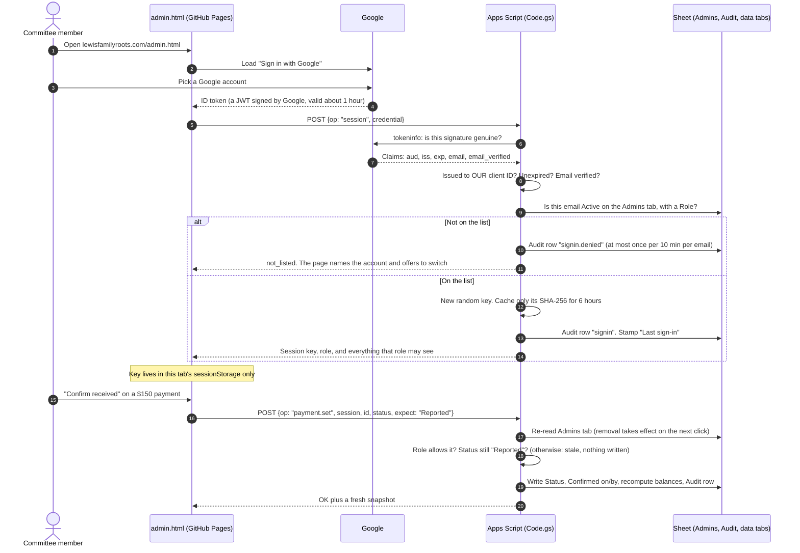

# Committee back office

A private console for the reunion committee at **`/admin.html`**. Committee members sign in with their Google account and can:

- confirm payments from a phone,
- look up any household and resend a lost link,
- hide a story or listing,
- see headcounts for catering, shirts and rooms,

all without opening the Sheet. The Sheet stays the source of truth. The console reads and writes the same tabs the committee already uses, and both ways of working run side by side.

## The flow



### Why this design

| Option | Verdict |
|---|---|
| **Sign in with Google on a static page, verified by Apps Script** (chosen) | Fits the existing setup: GitHub Pages, one Apps Script URL, and the Sheet. Works with ordinary Gmail accounts. No new servers, no new bills. |
| Apps Script web app set to "Execute as: user accessing" | Every member would need edit access to the Sheet. It also fails for people signed in to several Google accounts (the problem already noted in `Code.gs`), and the page would live on a `script.googleusercontent.com` address. |
| Firebase Auth, or a Cloud Run backend | Works, but adds a second backend, billing and upkeep for a handful of users. |

## Who can do what

Roles are set per person on the Sheet's **Admins** tab. Each person sees only the tabs their role needs.

| Can… | Owner | Treasurer | Coordinator | Viewer |
|---|:-:|:-:|:-:|:-:|
| See the Overview (counts, money totals, headcounts) | ✓ | ✓ | ✓ | ✓ |
| See households and contact details | ✓ | ✓ | ✓ | |
| Email a household a fresh private link | ✓ | ✓ | ✓ | |
| See payments | ✓ | ✓ | | |
| Confirm / mark not received / undo a payment | ✓ | ✓ | | |
| See stories, tributes and listings | ✓ | | ✓ | |
| Hide or show an entry | ✓ | | ✓ | |
| See the Activity log | ✓ | | | |

## Everyday jobs

**Confirm a payment (treasurer).**
1. Open **Payments**. *To review* lists what families reported.
2. Check the bank or app, then press **Confirm received**, or **Not received**.
3. A dialog repeats the household and amount before anything is written.
4. The family's balance updates straight away.
5. **Back to review** undoes a mistake.
6. If someone else changed that payment a moment earlier, nothing is overwritten. The console says so and refreshes.

**Help a family that lost their link.**
1. Open **Households**.
2. Search their name, open the row, and press **Email a fresh private link**.
3. Their old link stops working.

**Remove a post.** In **Entries**, flip **Showing** off. It disappears from the family pages at once and can be turned back on.

**Add or remove a committee member (owner).** This happens on the Sheet's **Admins** tab:

| Email | Name | Role | Active |
|---|---|---|---|
| `cousin@gmail.com` | Cousin Dee | treasurer | ✓ (ticked) |

Untick **Active** to lock someone out; it takes effect on their next click. Roles are `owner`, `treasurer`, `coordinator` and `viewer`.

## Security model

| Risk | What stops it |
|---|---|
| Someone finds `/admin.html` | It needs a Google account that is Active on the Admins tab. The page holds no data and is marked `noindex`. |
| A token minted for another website is replayed here | The server checks that `aud` equals our client ID. Google checks the signature, and `exp`, `iss` and `email_verified` are checked too. |
| A session key is stolen | It expires after 6 hours, with no extension. It is kept in one tab only, never in `localStorage` or a URL. Sign-out kills it on the server, and the server stores only its SHA-256. |
| A former committee member | Untick **Active**. The Admins tab is re-read on every request. |
| Two people act on the same payment | Optimistic concurrency: every change carries the status the person saw. If it changed meanwhile, nothing is written. |
| Cross-site scripting | Strict Content-Security-Policy: no inline scripts, and scripts load only from this site and Google's sign-in library. All family-typed text is escaped. |
| Clickjacking | The page refuses to render inside a frame. |
| Spreadsheet formula injection | Text is cleaned before every Sheet write, including the Audit tab. In the CSV export, cells that look like formulas are quoted. |
| Keys in logs or browser history | Admin calls are POST-only. A GET cannot reach them. |
| "Who changed this?" | Every sign-in, refused sign-in and change gets a row on the **Audit** tab. Payments also record **Confirmed by**. |

**Known trade-offs**

- Google recommends checking token signatures locally for high volume. Apps Script cannot verify RS256 itself, so we ask Google's `tokeninfo` endpoint. That is fine for a few sign-ins a day.
- The script cache can drop a session early. The member signs in again, usually in one tap.
- The web app runs as the person who deployed it, so Sheet edit history shows that account. The **Audit** tab and **Confirmed by** record the real committee member.
- **Export CSV** runs in the browser, so it is not logged. The file holds contact details; the console says so when it downloads.

## One-time setup (about 15 minutes)

1. **Create the Google sign-in client.**
   1. Go to [console.cloud.google.com](https://console.cloud.google.com) and create a project, for example *Lewis Reunion 2027*.
   2. Open **Google Auth Platform** (formerly "OAuth consent screen") → **Get started**.
   3. Enter an app name (*Lewis Reunion back office*), the committee email as support email, and **Audience: External**.
   4. Under **Audience**, set **Publishing status** to **In production**. Sign-in uses only basic profile and email, so no Google review is needed.
      - Alternatively, leave it in *Testing* and add each committee member as a test user, as a second lock.
   5. Under **Clients** → **Create client**, choose **Web application**.
   6. Under **Authorized JavaScript origins**, add `https://lewisfamilyroots.com`. For local testing, also add `http://localhost:8000`. No redirect URIs are needed.
   7. Copy the **Client ID**. It ends in `.apps.googleusercontent.com` and is public by design. There is no secret.
2. **Website.** Paste the client ID into `config.js` → `googleClientId` and commit.
3. **Backend.**
   1. In the Sheet, go to **Extensions → Apps Script** and replace the code with the new `apps-script/Code.gs`.
   2. Run **`setup`**. Approve the new permission, *Connect to an external service*, which is used only to ask Google to verify sign-ins.
   3. Setup adds the **Admins** tab (with you as the first owner), the **Audit** tab, and a `googleClientId` row on **Config**.
4. **Config tab.** Paste the same client ID into the `googleClientId` value.
5. **Deploy.** Go to **Deploy → Manage deployments → Edit → New version**. The URL stays the same.
6. **Invite the committee.** Add rows on the Admins tab, then send them `https://lewisfamilyroots.com/admin.html`.

If the client ID is missing from either place, the back office stays shut and says so.

## Testing

```sh
node --test            # backend: sign-in checks, roles, revocation, payments, moderation, audit (no installs)
python3 -m http.server 8000   # then open http://localhost:8000/admin.html (needs localhost on the client's origins)
```

## Next phases (proposed)

1. **Settings** (owner): fees, deadline, payment handles, `siteLive` and family-code rotation, from the console, with audit.
2. **Access** (owner): add, remove and re-role committee members without opening the Sheet.
3. **Check-in mode** for July 2: search a household, mark them arrived, print badges, and see a live headcount.
4. **Reminders**: email households with a balance before the deadline. This stays within MailApp's daily quota.
5. **Agenda editor**.
